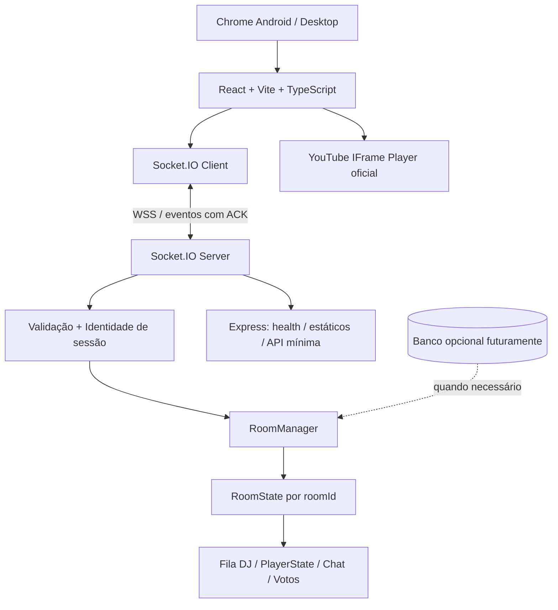

# VibeDJ — Auditoria e plano técnico de modernização

**Data:** 14/11/2026\
**Repositório analisado:** https://github.com/gustavobirello4-afk/VibeDJ (branch `main`)\
**Escopo:** inspeção estática do código publicado, documentação técnica e proposta de evolução. **Não foram executados testes, benchmarks ou alterações no repositório.**\
**Objetivo:** transformar um protótipo colaborativo de salas musicais sincronizadas em uma aplicação sustentável, segura, responsiva e leve, sem perder funcionalidades existentes.

## 1. Decisão de arquitetura

**Diretriz obrigatória — MOBILE-FIRST:** Android com Google Chrome é a plataforma
prioritária, mantendo compatibilidade com iOS Safari e desktop. Projetar primeiro
para smartphones e ampliar progressivamente para tablet/desktop; priorizar baixo
consumo de memória, CPU, bateria e dados, JavaScript mínimo, carregamento eficiente,
interações touch-first sem dependência de hover, acessibilidade, legibilidade e
movimento reduzido. Preservar funcionalidades durante a migração, resiliência em
redes móveis e instância persistente do player na navegação interna quando
permitido, sem garantir reprodução oculta, em segundo plano ou PiP externo.
Detalhamento normativo no [README](README.md); cenários e gates na
[matriz da Fase 0](docs/REGRESSION_MATRIX.md) e no
[relatório atualizado](docs/PHASE_0_REPORT.md). A inspeção estática original deste
documento é histórica; os testes executados posteriormente estão nesses registros.

**Recomendação:** manter React + Node.js + Express + Socket.IO e modernizar a entrega com **Vite, TypeScript e Tailwind compilado**, separando frontend, backend e contratos compartilhados. Introduzir **Zod**, **Vitest**, testes de integração Socket.IO e **Playwright** para cenários críticos. Usar **um único servidor Node.js/instância** no MVP, com estado por sala em memória; persistência e distribuição só quando surgirem requisitos validados.

**Não recomendar por enquanto:** reescrita para Svelte/Next.js, microserviços, Redis, Kubernetes, Firebase, PostgreSQL ou Cloudflare Durable Objects. Todos têm usos possíveis, mas adicionam custo/complexidade sem resolver os bloqueios atuais. Preact pode ser um experimento posterior medido, não um pré-requisito.

**Premissa essencial:** a base atual não tem várias salas independentes. Possui uma sala global (singleton `roomState`), apesar de usar a palavra "sala" na UI. A funcionalidade multi-sala precisará ser implementada.

## 2. Inventário confirmado do repositório

Arquivos presentes na árvore pública da `main`:

- `server.js`: 474 linhas (~17,3 KB): Express, Socket.IO, extração de áudio, fila de DJs, chat, votação, sincronização, estado global.
- `public/index.html`: 1.313 linhas (~70,6 KB): React via CDN, Babel no navegador (`text/babel`), Tailwind via CDN, CSS incorporado, JSX da interface, player YouTube, estado local, Socket.IO e UI.
- `package.json`: scripts apenas `start: node server.js`; dependências `express: ^4.18.2`, `socket.io: ^4.7.2`, `@distube/ytdl-core: ^5.2.1`.
- `package-lock.json`: lockfile npm.
- Não encontrados na árvore: README, testes, CI, `tsconfig`, configuração de build, `.gitignore`, documentação de API ou arquivos de configuração de ambiente.

Referências: [package.json](https://github.com/gustavobirello4-afk/VibeDJ/blob/main/package.json), [server.js](https://github.com/gustavobirello4-afk/VibeDJ/blob/main/server.js), [index.html](https://github.com/gustavobirello4-afk/VibeDJ/blob/main/public/index.html).

### Funcionalidades atuais a preservar

Entrada por apelido, playlist pessoal no `localStorage`, inclusão de vídeos/Shorts por URL, consulta de título via noembed, rearranjo e remoção da playlist, rodízio circular de DJs, reprodução com YouTube IFrame API, play/pause/seek/skip pelo DJ, voto Woot/Meh, chat, controle de volume local, adaptação do layout para mobile, estado da sala via Socket.IO, ressincronização e tolerância parcial a reconexões. Tratar como funcionalidades existentes, **não como comportamento correto ou plenamente testado**.

## 3. Achados com evidências e prioridade

| ID | Prioridade | Evidência estática | Risco / ação |
|---|---|---|---|
| A01 | P0 | `server.js` `isCurrentDj` aceita igualdade de nome; `set_user` associa privilégios ao mesmo nome | Usurpação de controle do DJ; criar identidade opaca por participante e prova de posse na reconexão |
| A02 | P0 | `roomState` singleton e `io.emit` global | Mistura de filas, reprodução, chat e votos; implementar estado isolado por sala + `socket.join` / `io.to(roomId)` |
| A03 | P0 para publicação | `/api/audio` e `/api/stream` usam `@distube/ytdl-core`; frontend cria buffer silencioso para manter áudio em segundo plano | Revisão imediata de conformidade com YouTube; não ampliar essas abordagens; remover após confirmar dependências e criar testes |
| A04 | P1 | `toggle_queue` e `update_playlist` aceitam arrays arbitrários, sem esquema/tamanho | Payloads excessivos, dados inválidos, consumo e quebras; validar ID de vídeo, título, playlist, limites |
| A05 | P1 | `getPublicRoomState()` faz spread integral de estado, com playlists e `votes.voters` | Overfetch, acoplamento, dados desnecessários; projeções públicas mínimas e eventos granulares |
| A06 | P1 | `track_ended` pode chamar `nextTrack` sem token de instância/versão; fallback apenas `elapsed > 10` sem DJ presente | Pulos indevidos, eventos atrasados e corrida; validar `trackInstanceId`, idempotência e regras por estado |
| A07 | P1 | `disconnectTimers` indexado por nome; reconexão pelo nome atualiza socket ID | Colisão e sequestro em reconexão; usar `participantId`, TTL, token de retomada |
| A08 | P1 | CORS HTTP e Socket.IO configurados com `*`; falta rate limiting | Superfície de abuso; restringir origens conforme implantação, limites por IP/usuário/sala, controles anti-spam |
| A09 | P1 | `handleLogout` só limpa `localStorage` e estado React | O socket permanece identificado; implementar logout servidor e saída de sala/limpeza de sessão |
| A10 | P1 | `onSyncTime` não verifica `currentTrackId`; player usa diversos efeitos/timers | Eventos antigos podem afetar nova faixa; serial/versão e testes de corrida / reconexão |
| A11 | P1 | JSX e Babel no navegador; React dev e Tailwind CDN | Trabalho de compilação em runtime, payloads e manutenção difíceis; migrar para Vite build preservando comportamento |
| A12 | P2 | Código inteiro em dois arquivos sem testes | Fragilidade de mudanças; modularizar incrementalmente e testar antes de novos recursos |
| A13 | P2 | Sobreposição transparente do vídeo para ouvintes e tentativa de PiP | Verificar requisitos de integridade e controles do YouTube; não ocultar nem bloquear funcionalidades obrigatórias do player |
| A14 | P2 | Playlist salva exclusivamente no navegador e estado global no processo | Perda após limpeza do navegador/restart; definir políticas explícitas de persistência e retenção |

**Classificação:** evidências A01–A14 são de leitura estática; impacto explorável, desempenho e compatibilidade exigem reprodução e testes. Não declarar que um ataque foi executado nem que um browser passou nos testes.

## 4. Arquitetura alvo (MVP de baixo custo)



**Deploy inicial preferido:** uma única instância Node.js servindo `dist/client` e Socket.IO na mesma origem. Reduz duas aplicações, CORS entre domínios e dependências operacionais. Servidor próximo do público, TLS, WebSocket, processo sempre ativo, healthcheck e logs. Não se comprometer com planos gratuitos que suspendam a instância e interrompam sockets.

**Escala futura:** múltiplos processos exigem um estado autoritativo compartilhado/particionado e um adapter Socket.IO; Redis adapter sozinho transporta broadcasts, **não replica automaticamente o objeto `RoomState`**. HTTP long-polling com múltiplos nós requer sticky sessions; conferir documentação antes da mudança.

## 5. Estrutura de código proposta (sem monorepo pesado)

```text
VibeDJ/
├── index.html
├── package.json
├── package-lock.json
├── vite.config.ts
├── tsconfig.json
├── tsconfig.server.json
├── eslint.config.js
├── public/                        # apenas assets estáticos
├── src/
│   ├── client/
│   │   ├── main.tsx
│   │   ├── App.tsx
│   │   ├── components/            # componentes UI reutilizáveis
│   │   ├── features/
│   │   │   ├── room/              # entrada, cabeçalho, participantes
│   │   │   ├── player/            # YouTubePlayer, useYouTubePlayer, sync
│   │   │   ├── playlist/          # adição, ordenação, persistência local
│   │   │   ├── dj-queue/          # rodízio e estado visual
│   │   │   └── chat/              # mensagens e notificações
│   │   ├── hooks/
│   │   ├── lib/socket.ts
│   │   └── styles/index.css
│   ├── server/
│   │   ├── index.ts              # bootstrap e shutdown
│   │   ├── app.ts                # Express, CORS, healthcheck
│   │   ├── realtime/             # handshakes, eventos, ACKs
│   │   ├── rooms/                # RoomManager, RoomState, regras
│   │   ├── identity/             # IDs e tokens de retomada
│   │   ├── validation/           # limites de entrada
│   │   └── observability/        # logs e métricas
│   └── shared/
│       ├── contracts.ts          # payloads cliente-servidor
│       ├── schemas.ts            # zod compartilhado
│       └── types.ts
├── tests/
│   ├── unit/
│   ├── integration/
│   └── e2e/
├── docs/
│   ├── ARCHITECTURE.md
│   ├── SOCKET_PROTOCOL.md
│   ├── CONVENTIONS.md
│   └── MIGRATION.md
└── .github/workflows/ci.yml
```

**Regra contra superengenharia:** só criar arquivos/pastas que tenham responsabilidade real. Um módulo pequeno pode ficar em um único arquivo. Não introduzir Redux, microserviços ou um sistema de design enorme.

## 6. Modelagem de salas e participantes

### Entidades mínimas

- `Room`: `roomId` opaco, código curto para convite se desejado, timestamps de criação/atividade, política de privacidade, `revision`, mapa de participantes, DJ queue, estado atual e mensagens limitadas.
- `Participant`: `participantId` aleatório, `displayName`, `avatar`, estado de conexão, `resumeToken` secreto com TTL/rotatividade. **Nome não é credencial.**
- `Track`: `youtubeVideoId` validado (11 caracteres), título limitado, fonte/metadados permitidos.
- `TrackInstance`: `trackInstanceId` único a cada entrada na rotação; separa reproduções repetidas do mesmo vídeo.
- `Playback`: `status` (`idle`, `playing`, `paused`), `trackInstanceId`, `positionMsAtReference`, `referenceServerTime`, `revision`; calcular tempo com timestamp do servidor.
- `Vote`: chave por `participantId` e `trackInstanceId`; um voto por pessoa/faixa, trocável se essa for a regra acordada.
- `ChatMessage`: identificador, remetente derivado da sessão, texto limitado, timestamp de servidor, limite de histórico e eventos para novas mensagens.

### Regras obrigatórias

1. Um socket pertence a, no máximo, uma sala ativa por vez no MVP. Entrada/saída atualiza `socket.join`/`leave` e `socket.data`.
2. Todos os comandos são aplicados à sala autenticada no servidor, nunca a um `roomId` arbitrário aceito sem validação.
3. Só o DJ efetivamente autorizado altera a reprodução coletiva; demais participantes controlam **volume/mudo local**.
4. Nome repetido é permitido; identidades são distintas. Reconexão exige posse de token válido; rotação de token quando necessário.
5. Quando o usuário sai da fila, decidir explicitamente o destino de uma faixa em execução; comportamento documentado e testado.
6. Fila de DJs e playlist por participante com limites e fairness definidos; evitar starvation e loop infinito.
7. Criar e entrar em salas por ID/código; nunca misturar chat, votos e músicas entre salas. Sala vazia expira após TTL definido.
8. Na falha de conexão, reentrar, pedir snapshot da sala e revalidar privilégios antes de enviar mutações.
9. Retornar ao estado `idle` quando não há faixa válida, sem falha do servidor.
10. Não usar `displayName`, `socket.id` isolado ou campos enviados pelo cliente como prova de autoridade.

### Contratos Socket.IO sugeridos (proposta, não APIs existentes)

| Cliente → servidor | Payload essencial | Confirmação / servidor → cliente |
|---|---|---|
| `room:create` | apelido e configurações válidas | ACK `{roomId, participant, snapshot}` ou erro |
| `room:join` | código/ID + token opcional | ACK de ingresso com snapshot |
| `room:leave` | — | ACK e atualização de presença |
| `room:resync` | `lastRevision` opcional | snapshot autoritativo |
| `queue:toggle` | intenção e playlist validada | ACK; `room:queueUpdated` na sala |
| `playlist:update` | faixa(s), limite e versão | ACK; atualização autorizada |
| `player:play/pause/seek/skip` | `expectedRevision`, instante alvo se aplicável | ACK e `room:playbackUpdated` |
| `player:ended` | `trackInstanceId` + revisão | ACK; próximo estado se autorizado e não duplicado |
| `vote:cast` | `trackInstanceId`, `woot` ou `meh` | ACK e atualização agregada |
| `chat:send` | texto limitado | ACK e `chat:message` |

Os nomes são **sugestão** para a arquitetura nova. Em migração, adaptar/compatibilizar eventos legados antes de eliminá-los. Respostas com erros tipados, ACK com timeout/retry apenas quando idempotente, `revision` monotônica, data/hora do servidor e payload mínimo por evento. Socket.IO garante ordem entre pacotes recebidos, não garante entrega de eventos offline por padrão; reconectar deve obter snapshot.

### Política de desconexão

Propor grace period configurável (p.ex. 15–30 s), mas determinar com testes mobile. Se o DJ desaparece, definir se faixa prossegue, pausa, passa ao próximo DJ ou aguarda. Nunca assumir que `track_ended` de um cliente representa conclusão verdadeira; não usar `elapsed > 10` como único critério. Introduzir idempotência por `trackInstanceId` e revisão para evitar pular duas faixas quando chegarem eventos atrasados.

## 7. YouTube, Android Chrome e PiP: fronteira funcional

- Preservar YouTube **IFrame Player API oficial**, visível, com controles/atribuições permitidos; observar tamanho mínimo 200×200 px da viewport do player e integridade de reprodução.
- Auditar e descontinuar os endpoints que extraem áudio (`@distube/ytdl-core`) após verificar todas as dependências; não usar um stream paralelo para simular PiP.
- Remover o pipeline de `AudioContext` quase silencioso destinado a manter reprodução em segundo plano; não criar mecanismo substituto que contorne política.
- Revisar a camada transparente sobre o iframe que bloqueia interação dos ouvintes; privilegiar permissões de comandos coletivos no **servidor** sem impedir funções obrigatórias do player oficial.
- Não prometer PiP nativo do Chrome Android para o iframe do YouTube. `allow="picture-in-picture"` não cria método oficial nem garante suporte. Não depender de PiP para o MVP.
- Mini-player **interno** apenas se respeitar políticas/tamanho/visibilidade; não ocultar player enquanto continua tocando quando a aba de chat é exibida sem avaliar conformidade.
- Testar autoplay bloqueado e fluxos iniciados com gesto do usuário; preferir erro claro e ação visível quando o player não puder iniciar.
- Se PiP fora do navegador for requisito inegociável, avaliar uma fonte de conteúdo com licenças e APIs que autorizem esse recurso, como produto separado.

Referências: [YouTube IFrame API](https://developers.google.com/youtube/iframe_api_reference); [YouTube Developer Policies](https://developers.google.com/youtube/terms/developer-policies); [Compliance guide](https://developers.google.com/youtube/terms/developer-policies-guide); [Required Minimum Functionality](https://developers.google.com/youtube/terms/required-minimum-functionality).

## 8. Plano de execução com PRs independentes e gates

**Sequência recomendada:** evitar um PR de reescrita integral. PRs pequenos e revisáveis, em branch do fork; manter `main` estável. Cada entrega precisa de critérios objetivos, testes e rollback.

### Fase 0 — Linha de base e documentação (PR-00)

**Objetivo:** caracterizar comportamento atual antes de migrar.

- Criar `README.md` com setup, scripts, arquitetura e avisos de limitações.
- Capturar fluxos (2 navegadores desktop, 2 celulares quando possível): login, playlist, fila, DJ, chat, votos, pausa, seek, skip, troca de aba, reconexão, saída.
- Elaborar matriz de regressão e mapa de dependências/eventos; registrar decisões com seu amigo.
- Criar testes de unidade para lógica pura extraída **sem alteração de comportamento**; testes de integração que conectam 2 clientes Socket.IO em servidor descartável.
- Estabelecer `npm ci`, script `test` e checagem mínima CI. Registro de screenshots e limites conhecidos.

**Aceite:** execução reproduzível e checklist de comportamento atual; problemas existentes marcados como baseline, nunca mascarados. Sem alterar UI.

### Fase 1 — Segurança e políticas críticas (PR-01 e PR-02)

**Objetivo:** eliminar riscos graves antes de tornar público.

- PR-01: introduzir `participantId` e `resumeToken`, autorização por identidade interna, proteção contra mesmo apelido, sessão limpa ao sair; testes contra sequestro de DJ.
- PR-02: validar payloads e limites (nome, avatar, URLs de vídeo, títulos, tamanho da playlist, texto do chat, eventos/segundo); erros padronizados; CORS/origens conforme ambiente; nunca confiar no apelido enviado em mensagens.
- Inspecionar dependência dos endpoints de áudio e das técnicas de background. Planejar remoção com testes e revisão das regras do player (pode ser um PR separado de conformidade antes de qualquer deploy público).

**Aceite:** clientes com apelidos idênticos não controlam ações um do outro; comandos não autorizados são rejeitados; entradas malformadas não derrubam servidor; APIs em desacordo ficam desabilitadas/removidas após verificação.

### Fase 2 — Build moderno mantendo a mesma interface (PR-03)

**Objetivo:** converter `index.html` em entrada HTML mínima e módulos React.

- Preparar Vite + React + TypeScript e Tailwind compilado; remover React dev/Babel/Tailwind runtime CDN.
- Extrair `App.tsx`, `YouTubePlayer`, `Chat`, `Playlist`, `DJQueue`, `RoomHeader`, `VolumeControl`; extrair estilos para CSS/Tailwind.
- Preservar layout, textos, regras e Socket.IO existentes. Mover inicialização/cleanup do socket e YT para hooks adequados.
- Configurar build determinístico de produção, source maps privados se aplicável, lazy loading com parcimônia.

**Aceite:** comportamento e aparência funcionalmente equivalentes em desktop e Android Chrome; build sem erro; sem Babel transpilation em runtime; player não é recriado desnecessariamente; comparar bundles e requisições antes/depois.

### Fase 3 — Backend modular e máquina de estados (PR-04)

**Objetivo:** separar transporte, validação e regras de negócio.

- Migrar gradualmente `server.js` para `src/server`, TypeScript e `RoomService`; aplicar funções puras para rodízio, pausa, seek, voto, timer.
- Definir `PlayerState` autoritativo e cálculo de progresso com carimbo temporal/versão.
- Criar contratos tipados compartilhados; ACK e tratamento de erros. Preservar eventos externos até concluir transição.
- Reduzir broadcasts de estado inteiro, sem criar divergência de clientes.

**Aceite:** testes determinísticos cobrindo fila, reprodução, reinicialização, eventos atrasados e reconexão; equivalência observável ao funcionamento documentado.

### Fase 4 — Salas independentes (PR-05 e PR-06)

**Objetivo:** permitir reuniões simultâneas sem vazamento de estado.

- `RoomManager: Map<roomId, RoomState>`; criação/entrada/saída/expiração; código de convite; `socket.join(roomId)` e `io.to(roomId)`.
- Atribuir sessão somente à sala ativa; migrar playlist/identidade e lifecycle por sala.
- Chat, votos, fila, DJ e reprodução devem ser totalmente isolados.
- Testar duas salas em paralelo, nomes repetidos, mudança de sala, reconexão e encerramento de sala vazia.
- Se desejado, manter sala `default` temporária para clientes legados; deprecar com prazo explícito.

**Aceite:** executar faixa, votar ou enviar chat na sala A não muda nada na B; a URL de convite abre a sala correta; não há dependência de `roomState` global.

### Fase 5 — Sincronização e resiliência mobile (PR-07)

**Objetivo:** diminuir drift, falsos skips e quebras no Chrome Android.

- `trackInstanceId`/`revision` em todas as mutações; clientes ignoram eventos antigos; snapshots após reconnect.
- Player persistente com criação/destruição controladas; resync ao voltar da aba e a cada intervalo adequado à visibilidade, sem polling agressivo.
- Deduplicar notificações de fim, ignorar respostas obsoletas e não usar seek corretivo para diferenças insignificantes.
- Tratar buffering, vídeo indisponível, bloqueio de autoplay e usuário sem áudio com estados claros.
- Testar troca de redes, perda de conexão, 2–5 clientes e mudança de visibilidade no Android real.

**Aceite:** sem pulos duplicados por evento antigo; resync consistente; sem vazamento de timers; métricas de drift e reconnect registradas.

### Fase 6 — UX, acessibilidade e qualidade visual (PR-08)

**Objetivo:** apresentar experiência premium sem aumentar peso desnecessário.

- Revisar home/entrada, criar/entrar em sala, convite, player, fila, playlist e chat.
- Estados de carregamento, desconectado, sala vazia, erro do YouTube, playlist vazia, acesso negado, reconexão.
- Feedback curto e claro com microinterações CSS simples; respeitar `prefers-reduced-motion`.
- Foco visível, contraste, labels, teclado, responsividade Android, zonas de toque confortáveis.
- Usar `design-director` após a estabilização funcional; não misturar redesign e migração estrutural no mesmo PR.

**Aceite:** smoke test em 360/390/768/1280 px; nenhuma funcionalidade inacessível por touch/teclado; zero regressão do player.

### Fase 7 — CI, observabilidade e lançamento piloto (PR-09)

**Objetivo:** segurança operacional e reprodução controlada.

- CI: `npm ci`, lint, typecheck, testes, build; opcional smoke Playwright em jobs específicos.
- `GET /healthz`, encerramento gracioso, logs estruturados sem tokens/PII desnecessária, monitoramento de erros.
- Deploy em instância única com HTTPS/WSS e modo staging; manter tag/release do protótipo para rollback.
- Teste de carga gradual e acompanhamento de conexões, memória, CPU, latência de ACK, drift, erros YT, reconexões e tamanho dos bundles.
- Pilotar com amigos e observação em Android Chrome; só depois integrar ao upstream do amigo.

**Aceite:** CI verde, testes reais, rollback documentado, erros críticos bloqueantes resolvidos, responsável pelo deploy definido.

## 9. Matriz mínima de testes de aceitação

| Cenário | Resultado exigido |
|---|---|
| Dois usuários com mesmo nickname | Têm IDs distintos; um não assume DJ do outro |
| Sala A e sala B simultâneas | Chat, músicas, fila, votos e play/pause isolados |
| Usuário não-DJ tenta play/skip por socket | Servidor rejeita; não altera sala |
| Playlist gigante/malformada | Erro tipado, limite aplicado, processo estável |
| Nome/avatar/URL malformados | Validação sem crash; noembed/YouTube recebem apenas IDs válidos |
| Logout com socket ativo | Privilégios removidos no servidor |
| Atualização de playlist enquanto toca | Rodízio consistente, sem perder faixa |
| Duas notificações `track_ended` | Próxima faixa apenas uma vez |
| Notificação de faixa antiga | Ignorada por `trackInstanceId`/revision |
| DJ desconecta e volta na janela TTL | Reassume somente com token válido |
| DJ não retorna | Política explícita aplicada sem travar sala |
| Foco e alternância de aba Android | Ao retornar, snapshot e resync corretos |
| Autoplay bloqueado no Chrome | UI explica o problema e permite gesto legítimo |
| Restart do processo | Estado volátil perdido conforme contrato; UI informa; não quebra |
| Queda de WebSocket | Recupera sessão/sala e revisões sem duplicar eventos |
| YouTube indisponível/erro de iframe | Feedback e recuperação sem loop infinito |
| Teclado e telas pequenas | Componentes acessíveis e sem overflow crítico |

**Testes:** Vitest para domínios puros, Socket.IO client + servidor descartável para autorização e eventos; Playwright para fluxos UI/emulação Android. **Emulação não substitui teste em Android Chrome físico**, especialmente áudio, autoplay e gestão da aba.

## 10. Metas de desempenho — propostas, não medições

- **Bundle:** iniciar mirando até ~200 KB gzip de JavaScript da aplicação, sem incluir bibliotecas e mídia externas do YouTube; ajustar após medir. CSS sem runtime de Tailwind.
- **Carregamento:** medir LCP, INP e CLS com Lighthouse/Web Vitals em mobile; metas aspiracionais LCP ≤2,5 s, INP ≤200 ms, CLS ≤0,1 sob cenário de rede definido.
- **Drift:** medir diferença observada entre participantes (p50, p95, máximo), com objetivo inicial de p95 ≤1,5 s em rede estável; validar se é atingível com as limitações do YouTube.
- **Reconexões:** registrar tempo da volta da rede até o snapshot correto; meta só depois de baseline.
- **Memória:** acompanhar heap do servidor por 10/50/100 usuários, volume de mensagens, timers ativos e salas expiradas. Limitar recursos por sala.
- **Eventos:** reduzir broadcasts integrais, payload por evento e polling; ACKs só onde necessários.
- **Custo:** acompanhar CPU, memória, banda do servidor e disponibilidade em plano real; a mídia do YouTube não deve ser retransmitida pelo VibeDJ.

As medições precisam separar o código próprio das requisições e dos custos do player YouTube. Nenhum número acima é benchmark realizado.

## 11. Deploy, persistência e escala

### MVP (recomendado)

Uma instância Node LTS, Express servindo frontend compilado, Socket.IO na mesma origem, TLS/WSS, ambiente de staging e produção, backup de configuração, logs/healthcheck. Memória por sala; playlist local com limitações documentadas. Hospedagem com processos persistentes, não suspensos automaticamente durante sessões ativas.

### Persistência se necessária

- SQLite se começar a ser necessário manter **salas/usuários/preferências** entre reinícios em **uma** instância com disco persistente, entendendo limitações da hospedagem.
- PostgreSQL gerenciado se houver múltiplas instâncias, contas, histórico, permissões ou requisitos transacionais que justifiquem.
- Redis/adapters para coordenação/pub-sub quando escalar sockets; **não substitui modelagem de estado persistente**.
- Cloudflare Durable Objects são alternativa arquitetural para uma sala por objeto e WebSockets persistentes, mas representam projeto/migração diferente; considerar apenas com carga e custos validados.

### Segurança e operação

Segredos no ambiente do servidor; rate limit por ação, validação de todos os eventos, configuração explícita de origens, TLS, dependências atualizadas/testadas, payload limitado, logs sem tokens, retenção limitada de chat, proteções de abuse/spam, check de licenças/termos e política básica de privacidade antes de coleta de dados. Não fazer scan invasivo em produção sem autorização.

## 12. Colaboração no fork com Codex

**Política vigente:** seguir [Git, revisão e publicação](docs/CONTRIBUTING.md).
Commits locais organizados estão autorizados; push e abertura de PR dependem de
autorização explícita. Revisão do mantenedor precede integração. Depois do merge,
atualizar a base local; correções posteriores são pontuais, sem reescrever o
histórico integrado. Usar PRs encadeados para dependências reais. Merge não
autoriza produção: verificar auto-deploy conectado à `main` antes do primeiro
merge, validar mudanças funcionais em homologação Android Chrome e exigir plano
de transição/testes/rollback para incompatibilidades.

1. `origin`: **fork do colaborador**; `upstream`: repositório do amigo. Confirmar com `git remote -v` antes de agir.
2. Atualizar fork com `upstream/main` em branch limpa, evitando force push.
3. Criar branches `docs/baseline`, `fix/identity-security`, `build/vite-typescript`, `refactor/server-domain`, `feat/multi-room`, `fix/sync-lifecycle`, `feat/ux-polish`.
4. Um PR por escopo. PR descreve objetivo, mudanças, evidências/testes, riscos, compatibilidade, screenshots quando pertinentes e plano de reversão.
5. Não editar `main` nem mesclar automaticamente. Combinar contratos e semântica de DJ/room com seu amigo antes de PRs que mudem o comportamento.
6. Preservar as skills do Codex existentes; não instalar frameworks/agentes além do necessário. `project-audit` primeiro, `fix-bug` e `implement-feature` por PR, `design-director` somente para a fase de interface.
7. Não reformatar ou refatorar o repositório inteiro junto com fixes importantes; diffs pequenos facilitam revisão de autoria compartilhada.

### Prompt sugerido ao Codex — iniciar Fase 0

> Atue como engenheiro responsável pela modernização incremental do VibeDJ. Leia integralmente o repositório atual e o plano `VibeDJ_Plano_Modernizacao_Arquitetura.md`. Primeiro, valide evidências e restrições reais; não aceite o plano como verdade sem conferir o código. Nesta etapa execute **somente a Fase 0**: caracterização de fluxos, inventário de eventos e dependências, setup reprodutível, plano de testes e documentação. Preserve comportamentos existentes; não implemente a nova stack, não altere segurança ou interface e não crie salas novas ainda. Se precisar criar arquivos para documentação/testes, faça-o apenas em branch de trabalho e explique o diff. Use dependências mínimas, valide comandos executados e informe PASS/FAIL/BLOCKED com evidências. Não faça push, PR, merge, deploy ou alterações globais do Codex sem autorização explícita. Ao final proponha o menor PR-00 possível com critérios de aceite e plano de rollback.

## 13. Critérios globais de aceite e bloqueadores

**Cada PR:** escopo único, lint/typecheck/test/build quando aplicáveis, sem segredos, sem regressões declaradas sem testes, documentação das mudanças, rollback possível.\
**Bloqueadores de produção:** usurpação de DJ, isolamento de salas incorreto, perda/duplicação de transição de música, regressão grave Android Chrome, dependência de extração de áudio/background não conforme, payloads malformados capazes de derrubar servidor.\
**Escopo fora da primeira modernização:** login social, monetização, rankings, chats persistentes, analytics complexo, voice chat, aplicativos nativos e PiP externo garantido. Só adicionar após prova de necessidade.

## 14. Referências oficiais

- [VibeDJ — repositório](https://github.com/gustavobirello4-afk/VibeDJ)
- [Vite — guia](https://vite.dev/guide/)
- [Vite — build](https://vite.dev/guide/build.html)
- [Socket.IO — rooms](https://socket.io/docs/v4/rooms/)
- [Socket.IO — garantias de entrega](https://socket.io/docs/v4/delivery-guarantees/)
- [Socket.IO — adapter](https://socket.io/docs/v4/adapter)
- [Playwright — emulação](https://playwright.dev/docs/emulation)
- [YouTube — IFrame API](https://developers.google.com/youtube/iframe_api_reference)
- [YouTube — políticas de desenvolvimento](https://developers.google.com/youtube/terms/developer-policies)
- [YouTube — guia de conformidade](https://developers.google.com/youtube/terms/developer-policies-guide)
- [YouTube — requisitos mínimos](https://developers.google.com/youtube/terms/required-minimum-functionality)

---

**Decisão:** começar pelo **PR-00 (linha de base, documentação e testes)** e não por uma reescrita de uma vez. Depois, tratar segurança/conformidade, build moderno, domínio do servidor, salas, sincronização e UX, nessa ordem. Ajustar a sequência quando testes do protótipo revelarem bloqueios reais.
